# CloudPath — System Architecture

## 1. Architectural Overview

**CloudPath** is a modular Cloud Security Posture Management (CSPM) and Identity Attack Path Analysis platform engineered around a strict separation between:
1. **Untrusted Configuration Ingestion & Normalization (`Module A & B`)**
2. **Graph-Theoretic IAM & Resource Traversal (`Module C`)**
3. **Explainable Weighted Risk Scoring & Remediation Intelligence (`Module E, F, G`)**
4. **Interactive Visual Exploration & Workspace-Isolated Persistence (`Module D & Security`)**

```mermaid
flowchart LR
    subgraph Input["1. Untrusted Offline Configs"]
        TF["Terraform HCL (.tf)"]
        TFP["Terraform Plan JSON"]
        IAMP["AWS IAM / Trust Policy JSON"]
        CFG["AWS Config / Custom JSON"]
    end

    subgraph Engine["2. CloudPath Analysis Engine (Python FastAPI + NetworkX / TS Parity)"]
        VAL["Static Validator & Sandbox\n(5 MB Cap, Zero Execution)"]
        NORM["Canonical Entity Normalizer\n(11 Node Types)"]
        EVAL["IAM Policy Evaluator\n(Explicit Deny > Allow, PassRole)"]
        GRAPH["Directed Multigraph Builder\n(NetworkX MultiDiGraph)"]
        TRAV["Path Discovery Engine\n(Cycle-Safe BFS/DFS + Dijkstra)"]
        RISK["Weighted Risk Engine (0-100)\n+ MITRE ATT&CK + Diffs"]
    end

    subgraph Storage["3. Tenant-Isolated Persistence"]
        SUPA["Supabase PostgreSQL\nRow Level Security (RLS)"]
    end

    subgraph UI["4. Next.js 15 App Router Frontend"]
        DASH["Posture Dashboard"]
        FLOW["React Flow Attack Graph"]
        INV["Path Investigations & Diffs"]
        REP["PDF & JSON Reports"]
    end

    Input --> VAL --> NORM --> EVAL --> GRAPH --> TRAV --> RISK
    RISK --> SUPA
    RISK --> UI
    SUPA --> UI
```

---

## 2. Component Responsibilities

### 2.1 Backend Analysis Service (`/backend`)
- **`backend/models.py`**: Defines strict Pydantic v2 schemas for `CloudAsset`, `GraphNode`, `GraphEdge`, `AttackPath`, `Finding`, `RiskBreakdown`, `MitreTechnique`, and `RemediationGuidance`.
- **`backend/importer.py`**: Validates and parses Terraform HCL, Terraform Plan JSON, IAM Policies, Role Trust Policies, AWS Config exports, and custom environment manifests without invoking any shell or Terraform binary.
- **`backend/iam_evaluator.py`**: Implements AWS IAM evaluation semantics:
  - Explicit `Deny` overrides any `Allow` statement across attached, inline, and group policies.
  - Detects privilege escalation combinations (`iam:PassRole` + `ec2:RunInstances` / `lambda:CreateFunction` / `ecs:RunTask`) and self-mutation primitives (`iam:CreatePolicyVersion`, `iam:AttachRolePolicy`, `iam:PutUserPolicy`).
- **`backend/analyzer.py`**: Constructs a NetworkX `MultiDiGraph`, runs cycle-safe simple-path enumeration and Dijkstra shortest-path calculation, and emits traceable findings.
- **`backend/risk_engine.py`**: Computes explainable 0–100 risk scores from five configurable weighted factors.
- **`backend/main.py`**: Exposes FastAPI endpoints (`/api/health`, `/api/demo`, `/api/analyze`, `/api/upload`, `/api/scans/{id}`, `/api/workspaces/{id}/purge`) with sliding-window rate limiting and `X-Workspace-Id` tenant isolation.

### 2.2 Frontend & Serverless Engine Parity (`/src`)
- **`src/lib/engine/ts-analyzer.ts`**: Deterministic TypeScript parity implementation of the graph and IAM evaluation engine so the Vercel deployment executes real-time analysis with zero cold-start failures even when an external container is offline, while seamlessly forwarding to `BACKEND_API_URL` when connected to the Dockerized FastAPI service.
- **`src/components/graph/AttackGraphCanvas.tsx`**: Custom React Flow canvas supporting layered topology layout, path isolation, critical path highlighting, severity filtering, resource search, and vector SVG export.

### 2.3 Database & Row Level Security (`/supabase`)
- **`supabase/migrations/20261110000000_cloudpath_schema.sql`**: Defines `cloudpath_workspaces`, `cloudpath_scans`, and `cloudpath_audit_logs` with PostgreSQL Row Level Security (RLS) policies ensuring users can only access their own workspaces or the read-only Northstar Financial demonstration workspace.
