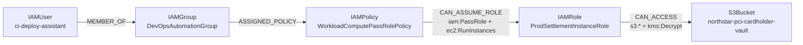

# CloudPath — Attack Path Analysis Engine Specification

## 1. Graph Representation

CloudPath models a cloud environment as a directed labeled multigraph $G = (V, E, \Sigma_V, \Sigma_E)$ implemented via NetworkX (`nx.MultiDiGraph`).

### 1.1 Vertex Types ($\Sigma_V$)
1. `IAMUser`: Human or machine IAM user principal.
2. `IAMRole`: Assumable AWS IAM role with an `AssumeRolePolicyDocument` (trust policy).
3. `IAMGroup`: Collection of IAM users inheriting group-attached policies.
4. `IAMPolicy`: Managed or inline policy document containing `Allow` and `Deny` statements.
5. `S3Bucket`: Object storage bucket with optional bucket policy and public access block flags.
6. `EC2Instance`: Compute workload optionally associated with an IAM instance profile role and security groups.
7. `SecurityGroup`: Virtual firewall governing ingress/egress CIDRs and ports.
8. `VPC`: Virtual Private Cloud network boundary.
9. `ExternalPrincipal`: Third-party AWS account root (`arn:aws:iam::<account>:root`) or anonymous wildcard principal (`*`).
10. `SensitiveResource`: High-value KMS keys, Secrets Manager secrets, or production settlement vaults.
11. `TrustRelationship`: Explicit cross-account or service trust boundary node.

### 1.2 Directed Edge Types ($\Sigma_E$)
Every directed edge $(u, v, k) \in E$ represents a verifiable configuration relationship or evaluated permission transition:
- `MEMBER_OF`: `IAMUser` $\to$ `IAMGroup`
- `ASSIGNED_POLICY`: `IAMUser | IAMGroup | IAMRole` $\to$ `IAMPolicy`
- `CAN_ASSUME_ROLE`: Principal or Policy $\to$ `IAMRole` (via `sts:AssumeRole`, `iam:PassRole` + compute execution, or EC2 instance profile attachment)
- `TRUSTS`: `ExternalPrincipal` $\to$ `IAMRole` (when the role's trust policy permits an external AWS account or `*`)
- `HAS_PERMISSION`: Principal $\to$ Permission capability
- `PUBLICLY_ACCESSIBLE`: `SecurityGroup` (with `0.0.0.0/0` ingress) $\to$ `EC2Instance`
- `CAN_ACCESS`: Principal or Policy $\to$ `S3Bucket | SensitiveResource`
- `CONNECTS_TO`: `VPC` $\to$ `SecurityGroup` $\to$ `EC2Instance`
- `CONTROLS_RESOURCE`: Principal with policy-modification primitives (`iam:CreatePolicyVersion`, `iam:AttachRolePolicy`) $\to$ critical roles/vaults

---

## 2. IAM Policy Evaluation Semantics

For each principal $u \in V$, CloudPath aggregates all applicable statements from:
- Directly attached managed policies (`ASSIGNED_POLICY`)
- Inline policies embedded on the principal
- Policies inherited via `MEMBER_OF` group edges

When evaluating whether action $a$ is permitted on resource $r$:
1. **Explicit Deny Precedence**: If any applicable statement has `Effect == "Deny"` where $\text{match}(A_{\text{stmt}}, a) \land \text{match}(R_{\text{stmt}}, r)$, the action is **denied** (`False`), overriding any wildcard `Allow` (`*:*`).
2. **Explicit Allow**: Otherwise, if at least one statement has `Effect == "Allow"` where $\text{match}(A_{\text{stmt}}, a) \land \text{match}(R_{\text{stmt}}, r)$, the action is **allowed** (`True`).
3. **Default Deny**: If no `Allow` statement matches, the action is implicitly **denied** (`False`).

---

## 3. Traversal Algorithms

1. **Multi-Hop Simple Path Discovery (Cycle-Safe DFS/BFS)**:
   - Enumerates all cycle-free simple paths from entry nodes (`IAMUser`, `ExternalPrincipal`, public `SecurityGroup`) to high/critical target nodes (`S3Bucket`, `SensitiveResource`) up to depth $k = 6$.
   - Because traversal tracks visited vertices along the active branch, mutual role-assumption loops (`RoleA` $\leftrightarrow$ `RoleB`) terminate cleanly without infinite recursion.
2. **Shortest Attack Path Calculation (Dijkstra)**:
   - Assigns each edge an exploitation friction weight $w(e) \in [0.5, 1.1]$ and computes the minimum-weight / minimum-hop path between every `(entry_point, target)` pair using Dijkstra's algorithm (`nx.shortest_path`).
