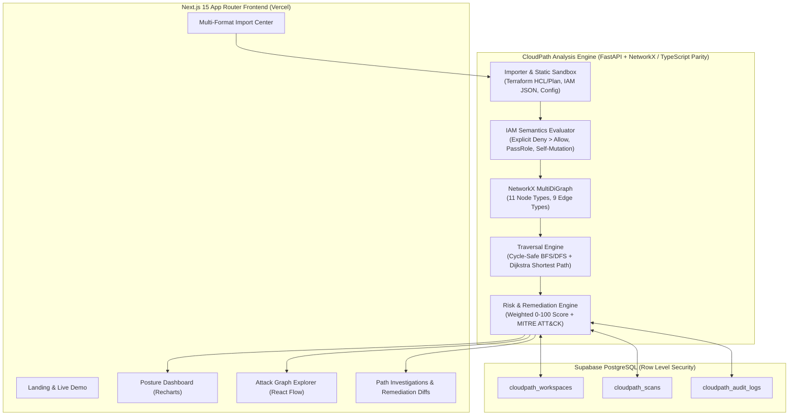

# CloudPath — Cloud Attack Path Mapper & Identity Risk Intelligence Platform

[](https://github.com/GorillaBrain/cloudpath/actions)
[](LICENSE)
[](#6-technology-stack)

## 1. Project Introduction

**CloudPath** is an enterprise-grade **Cloud Security Posture Management (CSPM)**, **Cloud Identity Security (CIEM)**, and **Graph-Based Attack Path Analysis** platform. It ingests declarative cloud configurations (Terraform HCL, Terraform Plan JSON, AWS IAM Policies, Role Trust Policies, and AWS Config exports) and constructs an interactive directed multigraph showing how identities, permissions, trust boundaries, and network exposures chain together to reach sensitive cloud resources.

---

## 2. Problem Statement

Cloud security failures rarely stem from a single isolated misconfiguration. Instead, attackers chain together seemingly benign configurations:
- A CI/CD IAM user belongs to an automation group (`MEMBER_OF`).
- That group attaches a policy permitting `iam:PassRole` + `ec2:RunInstances` (`ASSIGNED_POLICY`).
- That primitive allows attaching a privileged production role (`ProdSettlementInstanceRole`) to a compute workload (`CAN_ASSUME_ROLE`).
- That role holds `s3:*` and `kms:Decrypt` over a PCI-DSS Level 1 cardholder vault (`CAN_ACCESS`).

Traditional flat compliance scanners list dozens of low-context alerts without showing how they connect. **CloudPath** solves this by evaluating AWS IAM policy semantics (including explicit `Deny` precedence), building a directed identity-to-resource graph, calculating shortest attack paths (Dijkstra) and multi-hop blast radius (cycle-safe BFS/DFS), and generating copy-ready least-privilege remediation diffs.

---

## 3. Core Features

- **Multi-Format Offline Configuration Importer (`Module A`)**:
  - Supports Terraform HCL (`.tf`), Terraform Plan JSON, AWS IAM Policy JSON, IAM Role Trust Policy JSON, AWS Config exports, and custom environment manifests.
  - 100% read-only offline analysis—**never requests live AWS credentials** and **never executes uploaded code**.
- **Cloud Asset Discovery & Inventory (`Module B`)**:
  - Normalizes 11 cloud entity classes (`IAMUser`, `IAMRole`, `IAMGroup`, `IAMPolicy`, `S3Bucket`, `EC2Instance`, `SecurityGroup`, `VPC`, `ExternalPrincipal`, `SensitiveResource`, `TrustRelationship`) with multi-faceted filtering and raw JSON evidence inspection.
- **Graph-Based Attack Path Analysis Engine (`Module C`)**:
  - Evaluates explicit `Deny` overriding `Allow`, wildcard actions/resources (`*:*`), `iam:PassRole` + compute execution escalation, IAM policy self-modification (`iam:CreatePolicyVersion`, `iam:AttachRolePolicy`), unconstrained cross-account `sts:AssumeRole` trusts, public S3 policies, and `0.0.0.0/0` security group ingress on EC2 instances with IMDSv1.
- **Interactive React Flow Attack Graph Explorer (`Module D`)**:
  - Custom node shapes/icons, severity badges, path isolation, critical path highlighting, search, zoom/pan, SVG vector export, and a side inspection drawer.
- **Transparent & Configurable Risk Scoring Engine (`Module E`)**:
  - Documented 0–100 weighted formula (`Exposure + Privilege + Sensitivity + Reachability + Trust`) with live user-configurable weights in Workspace Settings.
- **Attack Path Investigations & MITRE ATT&CK Mapping (`Module F`)**:
  - Hop-by-hop narrative dossiers mapped to MITRE ATT&CK Cloud (`T1078.004`, `T1098.001`, `T1098.003`, `T1199`, `T1190`, `T1530`), clearly distinguishing static configuration weaknesses from observed security incidents.
- **Actionable Remediation Intelligence (`Module G`)**:
  - Side-by-side **Before vs. Suggested Least-Privilege Configuration** diffs, operational impact warnings, and remediation priorities.
- **Northstar Financial Technologies Enterprise Demo Environment**:
  - Pre-loaded realistic AWS environment analyzed dynamically by the real engine so visitors can explore 16 assets, 5 multi-hop attack paths, and 8 findings immediately.

---

## 4. Application Views & Screenshots

1. **Landing Page**: Product positioning, live trace preview, architecture pipeline, and zero-credential security guarantees.
2. **Posture Overview Dashboard**: Real-time metric cards, prioritized attack paths, interactive topology preview, Recharts severity/asset distributions, and findings table.
3. **Attack Graph Explorer**: Full-screen React Flow topology with path isolation, critical path highlighting, SVG export, and hop inspector.
4. **Security Findings**: Filterable vulnerability table with explainable risk factor breakdown and before/after JSON remediation diffs.
5. **Cloud Asset Inventory**: Searchable inventory across IAM, S3, EC2, Security Groups, and Secrets Manager with deep JSON evidence drawer.
6. **Path Investigations**: Step-by-step attack path narrative, entry/intermediate/destination cards, MITRE ATT&CK techniques, and remediation diff.
7. **Compliance & Reports**: Print-ready PDF executive dossier and full JSON report export.
8. **Import Center**: Drag-and-drop and live code editor for `.tf` HCL and `.json` manifests with instant reference presets.
9. **Workspace & Scoring Settings**: Supabase operator authentication, RLS workspace isolation switcher, real-time 5-factor risk weight sliders, and workspace purge.

---

## 5. Architecture Diagram



---

## 6. Technology Stack

| Layer | Technologies |
| :--- | :--- |
| **Frontend** | Next.js 15 (App Router), TypeScript 5.8, Tailwind CSS 4, `@xyflow/react` (React Flow 12), Recharts, Lucide Icons |
| **Backend Analysis Engine** | Python 3.12+, FastAPI, Pydantic v2, NetworkX 3.3 (`MultiDiGraph`), Uvicorn |
| **Database & Auth** | PostgreSQL via Supabase (`@supabase/supabase-js`) with Row Level Security (RLS) |
| **Testing & QA** | Pytest (Backend engine & API security tests), Vitest (Frontend TypeScript engine parity tests) |
| **DevOps & Deployment** | Vercel (Frontend & API parity routes), Docker & Docker Compose (Standalone Python container), GitHub Actions CI |

---

## 7. Installation Instructions (Running Locally)

### Prerequisites
- **Node.js** 20+ and `npm`
- **Python** 3.11+ and `pip`
- **Docker** (optional, for containerized backend deployment)

### Step 1: Clone the Repository
```bash
git clone https://github.com/GorillaBrain/cloudpath.git
cd cloudpath
```

### Step 2: Start the Python FastAPI + NetworkX Backend
```bash
pip install -r backend/requirements.txt
PYTHONPATH=. uvicorn backend.main:app --reload --port 8000
```
The FastAPI OpenAPI documentation will be available at `http://localhost:8000/docs` and health check at `http://localhost:8000/api/health`.

### Step 3: Start the Next.js Frontend
```bash
npm install --legacy-peer-deps
npm run dev
```
Open `http://localhost:3000` in your browser.

---

## 8. Environment Variables

Copy `.env.example` to `.env.local`:

```env
NEXT_PUBLIC_SUPABASE_URL=https://bwgilftdthajqenyocet.supabase.co
NEXT_PUBLIC_SUPABASE_ANON_KEY=your-supabase-publishable-key
NEXT_PUBLIC_BACKEND_URL=http://localhost:8000
BACKEND_API_URL=http://localhost:8000
```

---

## 9. Example Configuration Files

You can test the **Import Center** immediately using the built-in templates or by uploading a `.tf` file such as:

```hcl
resource "aws_iam_user" "ci_bot" {
  name = "github-deploy-bot"
}

resource "aws_iam_role" "prod_admin" {
  name = "ProdAdminRole"
  assume_role_policy = jsonencode({
    Version = "2012-10-17"
    Statement = [{
      Effect    = "Allow"
      Principal = { AWS = "*" }
      Action    = "sts:AssumeRole"
    }]
  })
}

resource "aws_s3_bucket" "vault" {
  bucket = "corp-customer-pii-vault"
  acl    = "public-read"
}
```

---

## 10. How Attack Path Analysis Works

See [ATTACK_PATH_ENGINE.md](ATTACK_PATH_ENGINE.md) for the complete mathematical and algorithmic specification.
1. **Entity Normalization**: Parses users, groups, roles, policies, S3 buckets, EC2 instances, security groups, VPCs, and external principals.
2. **Effective Permission Resolution**: Evaluates all attached, inline, and group-inherited statements per principal, ensuring explicit `Deny` statements override wildcard `Allow` statements.
3. **Edge Inference**: Creates directed edges only where justified by configuration evidence (`MEMBER_OF`, `ASSIGNED_POLICY`, `CAN_ASSUME_ROLE`, `TRUSTS`, `PUBLICLY_ACCESSIBLE`, `CAN_ACCESS`, `CONNECTS_TO`, `CONTROLS_RESOURCE`).
4. **Graph Traversal**: Executes cycle-safe simple path discovery (`cutoff=6`) and Dijkstra shortest-path calculation between entry points and high/critical targets.

---

## 11. Risk Scoring Methodology

See [RISK_SCORING.md](RISK_SCORING.md) for full details.
$$\text{RiskScore} = 0.25 \cdot \text{Exposure} + 0.25 \cdot \text{Privilege} + 0.20 \cdot \text{Sensitivity} + 0.15 \cdot \text{Reachability} + 0.15 \cdot \text{Trust}$$
Normalized to `0–100` (`0–19` Informational, `20–39` Low, `40–59` Medium, `60–79` High, `80–100` Critical).

---

## 12. Supported AWS Configuration Types

1. Terraform HCL (`.tf`) — `aws_iam_user`, `aws_iam_role`, `aws_iam_group`, `aws_iam_policy`, `aws_s3_bucket`, `aws_instance`, `aws_security_group`, `aws_vpc`, `aws_secretsmanager_secret`, `aws_kms_key`.
2. Terraform Plan JSON (`terraform show -json`).
3. Standalone AWS IAM Policy JSON (`Version`, `Statement`).
4. Standalone AWS IAM Role Trust Policy JSON (`AssumeRolePolicyDocument`).
5. AWS Config / `aws iam get-account-authorization-details` JSON exports.
6. CloudPath Custom Environment JSON manifests.

---

## 13. Limitations

- **Static Scope**: CloudPath v1.0 evaluates static IAM and resource configurations. It does not ingest live AWS CloudTrail runtime event streams or AWS Organizations Service Control Policies (SCPs) unless included in the uploaded manifest.
- **Subset of IAM Conditions**: Evaluates `sts:ExternalId`, `aws:MultiFactorAuthPresent`, and `iam:PassedToService`; complex dynamic runtime context keys (such as `aws:PrincipalOrgID` or `aws:SourceVpce`) are flagged with adjusted confidence scores rather than full runtime simulation.
- **Provider Focus**: First release prioritizes AWS IAM, S3, EC2, Security Groups, VPC, and Secrets Manager; Azure Entra ID and GCP IAM are planned on the modular provider roadmap.

---

## 14. Security Considerations

See [THREAT_MODEL.md](THREAT_MODEL.md) and [SECURITY.md](SECURITY.md).
- Uploaded files are treated as untrusted input (5 MB max size, UTF-8 text validation, script shebang rejection, zero shell/Terraform execution).
- Workspace isolation is enforced via `X-Workspace-Id` verification and Supabase PostgreSQL Row Level Security (RLS).

---

## 15. Testing Instructions

```bash
# Run Python Backend Engine & Security Test Suite (9 tests)
PYTHONPATH=. pytest tests/backend -v

# Run Frontend TypeScript Engine Parity & Security Test Suite (5 tests)
npm test
```

---

## 16. Deployment Instructions

- **Frontend & Serverless API**: Deploy directly to **Vercel** (`vercel --prod`).
- **Standalone Python Container**: Build and run via Docker:
  ```bash
  docker compose up --build -d
  ```
- **Database**: Apply `supabase/migrations/20261110000000_cloudpath_schema.sql` to your Supabase PostgreSQL project.

---

## 17. Roadmap

- [ ] **v1.1**: AWS Organizations Service Control Policy (SCP) & Permission Boundary intersection evaluation.
- [ ] **v1.2**: Azure Entra ID & Azure RBAC graph provider module.
- [ ] **v1.3**: GCP IAM & Service Account impersonation graph provider module.
- [ ] **v1.4**: Optional read-only AWS CloudTrail Access Advisor integration for unused-permission pruning.

---

## 18. License

Released under the [MIT License](LICENSE).
